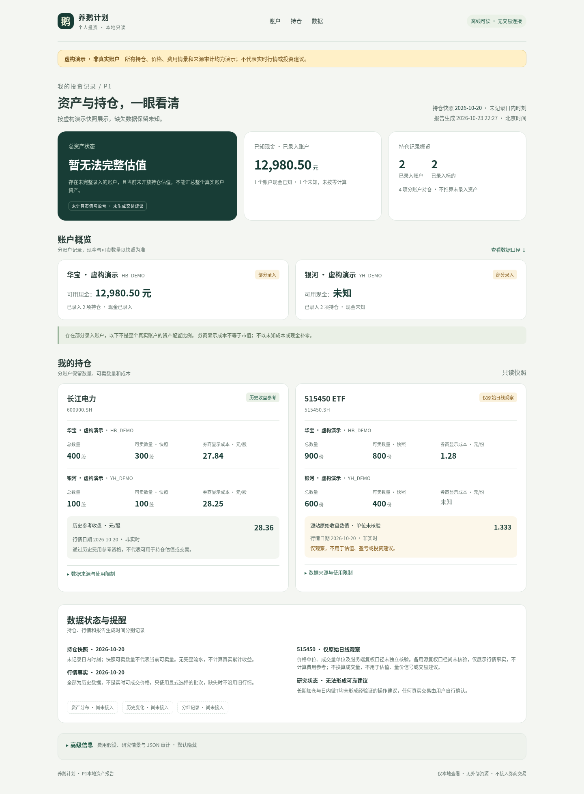

# P1本地资产仪表盘：本轮功能与Windows验收

## 最简单的操作

重新下载原Draft PR #3分支ZIP，解压到**新的独立代码目录**，进入`p1`：

- 先双击`查看虚构演示.cmd`，默认浏览器打开明确标注“虚构演示”的仪表盘。无需输入持仓、账户或密钥，不访问网络。
- 再双击`生成资产报告.cmd`，选择已有`snapshots`中的持仓JSON，选择同一P1数据目录`market`中的行情JSON（可多选，可留空），点击“生成并打开报告”。同标的只选择一份日线，不自动挑最新。
- 每次生成新HTML，保存在原私有数据目录`reports`；输入与旧报告不覆盖。实际文件只留在本机，不需要回传持仓或报告。

两入口优先复用`%LOCALAPPDATA%\GooseP1SinaTools-K2-1.19.1\Scripts\python.exe`；不存在时用已有`py -3.12`。本轮**没有新增或升级任何运行依赖**。报告仅需Python标准库，文件选择窗口使用Windows Python自带Tkinter，不需要重新安装K2工具。

若双击入口不可用，在新代码的`p1`文件夹打开PowerShell，复用已有解释器：

```powershell
$P1Py = Join-Path $env:LOCALAPPDATA 'GooseP1SinaTools-K2-1.19.1\Scripts\python.exe'
& $P1Py -m goose_research.report_wizard
```

原有`python -m goose_research --data-dir ... report ... --market ...`命令兼容，生成的也是新版界面。未有快照时先按[CSV导入说明](README.md)在本机建立，不是选择券商原始CSV给报告窗口。窗口不会导入、修改或猜测持仓。

## 实际完成的界面

1. 自适应中文首页：总资产状态、已知现金合计、已录入账户/标的数量，分别展示持仓日期与报告生成时刻。
2. 账户概览：券商及匿名账户、现金、部分/完整录入状态；现金未知不当零，已知现金合计不是总资产。
3. 持仓卡片：长江电力、515450优先展示；其他持仓同样保留。各账户的数量、可卖数量、券商显示成本分开展示，不混算平均成本。没录入重点标的显示“未录入，不代表未持有”。
4. 行情状态：已通过既有历史费用资格的日线展示历史参考收盘；Sina未知单位/复权行情仅展示原始数值、日期和限制，不标元、不乘除成交量、不进入估值/盈亏/费用/建议。
5. 缺失、采集失败、只有分钟行情或多份不明确日线均有中文提示，不显示空数组或null，不自动选择旧批次。
6. 每张卡片的数据与限制可展开；佣金、印花税、过户费、滑点、原100股/份费用情景及JSON审计统一置于默认关闭的“高级信息”。顶部账户/持仓/数据导航可点击跳转，键盘可展开/收起。
7. 无外部字体、图标服务、脚本或CDN，HTML内嵌CSS，断网可查看。继续使用原CSP、转义与本地文件安全限制。
8. Windows本地文件选择窗口和显式虚构演示入口；可先验收UI，无需触及真实文件。

**本轮没有开放持仓估值**：`market_usage.position_valuation`仍false，因此总资产始终明确“暂无法完整估值”，不会拿成本或原始行情算市值/盈亏。通过历史费用参考资格也不等于通过持仓估值资格。

资产分布、历史变化、分红记录只留待接入提示，无虚构图表。手机视口适配已经完成，实际iPhone Safari操作、手机安全访问、V2真实数据接入、云同步尚待后续独立验收。本轮不建后台、不启动常驻服务、不部署。

## 虚构界面截图

截图全部由`report_demo.fixtures()`生成，所有账户、数量、价格和审计均为虚构，不是行情实测或私人持仓：

[电脑完整界面](../docs/assets/p1-dashboard/desktop-demo.png) · [iPhone尺寸首页](../docs/assets/p1-dashboard/iphone-home-demo.png) · [iPhone尺寸持仓](../docs/assets/p1-dashboard/iphone-holdings-demo.png)



## 只读结构与隔离

`report_model.build_view_model(snapshot, markets)`复用原`validate_snapshot`、`validate_market`及`market_usage`，只生成内存中的独立投影，不读写文件、不联网、不改变上游资格。字段包括`view_version`、`is_demo`、`snapshot_as_of`、`snapshot_at=null`、`generated_at`、分账户事实、持仓卡片、行情状态、采集/行情时间、已知现金覆盖和原审计。

金额保持十进制字符串，数量为整数，未知保持None；HTML只在展示层转为中文。没有日内时刻就不补造；原始Sina价格不贴人民币单位；所有估值、盈亏、建议及扩展模块保持空值。金额展示可保留两位小数，不修改源值。旧模型不提供快照ID/批次ID，这里也不从私有路径伪造，未来适配器需显式补充来源身份。

后续V2可复用该结构与资格判断。本轮不导出真实JSON给V2，不内嵌可执行JSON脚本、不加入API、写回、同步或演示数据自动回填。真实报告入口从不调用演示fixture；不附行情就明确缺失。

## 验证与本机验收

新增14项Python回归：未知/零、禁止Sina定价、输入不变/投影不别名、三个时间分离、已获资格ETF与观察状态区分、歧义批次禁止费用、缺失/失败/分钟/歧义状态、其他标的不丢失、高级信息默认折叠、HTML注入转义、演示隔离、输入哈希保持与越界拒绝、真实无Git/cp1252演示子进程、Windows原生Tk窗口构建。旧行情、费用、安全和ZIP测试继续运行，最终Windows/Linux CI结果见PR #3。

已有开发工具中的Playwright/Chromium另测1440、430、390、320像素宽度：无横向溢出，默认不展示技术字段，点击导航、鼠标/键盘折叠正常；加载后断网仍可操作，外部HTTP请求与页面异常均为0。检查脚本为`tests/browser_dashboard.cjs`，不向用户环境安装浏览器依赖。

开发环境浏览器策略不允许file URL，因此截图仅把**虚构HTML**放在临时127.0.0.1回环服务器上验证，完成即停止；没有发布、云服务或真实文件上传。用户Windows仍直接打开本地HTML，不需该服务器。

本机验收只需核对：账户/数量/可卖/成本与快照相同；未知仍未知；不附行情显示清楚的原因；515450若为Sina观察则无市值/盈亏/费用；高级信息初始关闭；重复生成不改旧文件。无需提供私人数据。若失败，退回上一份独立P1源码重新生成即可；旧数据和旧报告保留，无迁移，无V1.1/Bark/任务变更。
